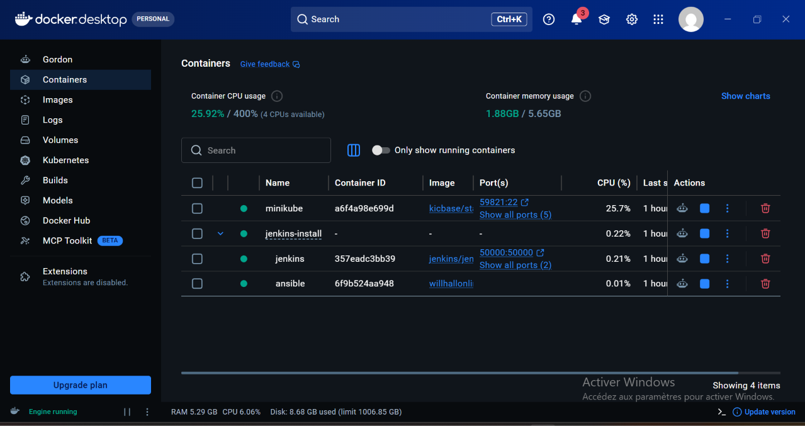
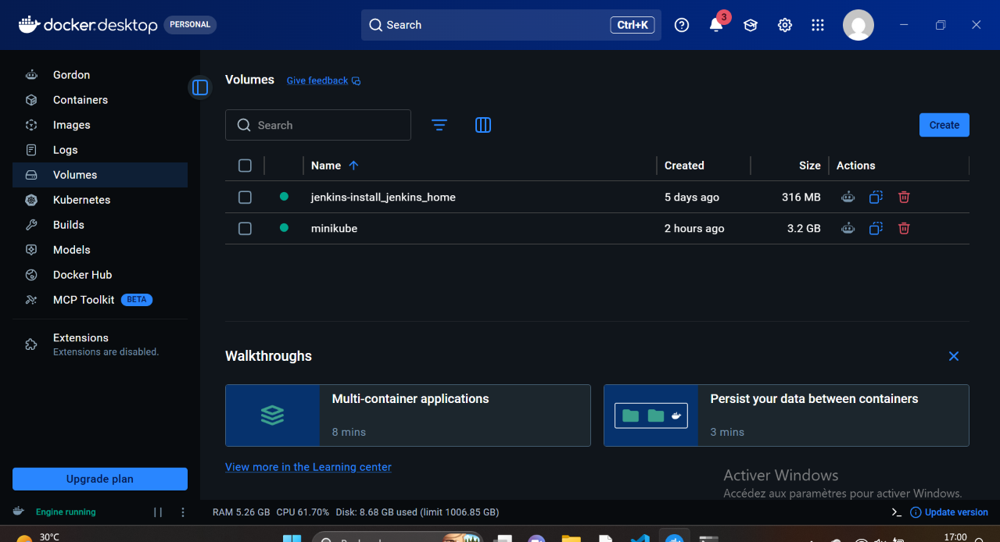
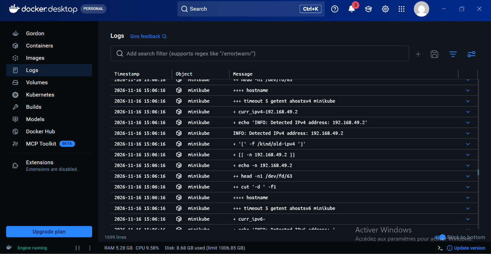
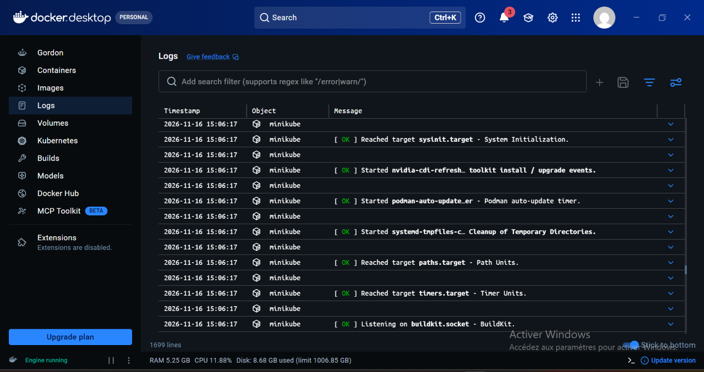
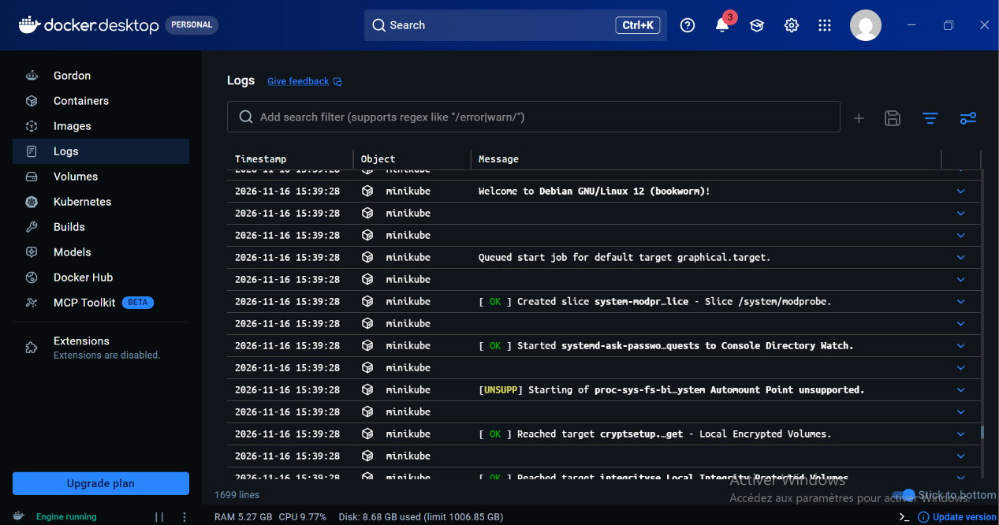

# Module 4 — Kubernetes et Ansible : TP 4.2 à 4.6

**Statut :** terminé le 16/11/2026 — tous les TP appliqués et vérifiés sur Minikube.

## Environnement

- Minikube 1.39.0, pilote Docker, Kubernetes **1.37.0**, nœud `minikube` Ready (2 CPU, 3 Go).
- `kubectl` 1.34.1.
- Démarrage : `minikube start --driver=docker --base-image=kicbase/stable:v0.0.51` (l'image de base a été téléchargée d'abord avec `docker pull`, car le téléchargement depuis `gcr.io` échouait).

## Organisation

| Dossier | TP | Fichiers |
|---|---|---|
| [`4.2-pod/`](4.2-pod/) | 4.2 Pod | `pod.yaml` |
| [`4.3-deployment-service/`](4.3-deployment-service/) | 4.3 Deployment + Service | `deployment.yaml`, `service.yaml` |
| [`4.4-webapp/`](4.4-webapp/) | 4.4 WebApp | `webapp-deployment.yaml`, `webapp-service.yaml` |
| [`4.5-4.6-wordpress/`](4.5-4.6-wordpress/) | 4.5 WordPress, 4.6 Ansible | `mysql-deployment.yaml`, `wordpress-deployment.yaml`, `wordpress-service.yaml`, `wordpress-playbook.yaml` |

## TP 4.2 — Pod

`kubectl apply -f 4.2-pod/pod.yaml` → `my-pod` **Running** (IP 10.244.0.3).
`kubectl describe pod my-pod` montre les événements : *Scheduled → Pulling → Pulled → Created → Started*.
`kubectl port-forward pod/my-pod 8080:80` → `http://localhost:8080` affiche *Welcome to nginx*.

## TP 4.3 — Deployment, Service, réplicas

`kubectl apply -f 4.3-deployment-service/` → `my-deployment` **3/3**, `my-service` NodePort `80:31796`.
- Le Service répond **200** sur le NodePort.
- **Auto-réparation :** après `kubectl delete pod my-deployment-…`, un nouveau pod est créé automatiquement et le Deployment revient à 3/3.
- Remarque : `my-pod` (TP 4.2) porte aussi le label `app: myapp`, il reçoit donc aussi du trafic du Service : les labels relient les objets, pas les noms.

## TP 4.4 — WebApp

`kubectl apply -f 4.4-webapp/` → `webapp-deployment` **2/2** avec l'image `legeni/webapp:v1`, `webapp-service` `8180:31917`.
Le Service répond **200** (`<title>Welcome</title>`). Le Service traduit le port 8180 vers le port 80 du conteneur.

## TP 4.5 — WordPress + MySQL

`kubectl apply -f mysql-deployment.yaml -f wordpress-deployment.yaml -f wordpress-service.yaml`
- PVC `mysql-pv-claim` **Bound** (2 Gi, StorageClass `standard`).
- `mysql` et `wordpress` **Running** ; la base `wordpress` existe (`SHOW DATABASES`).
- WordPress répond `302 → /wp-admin/install.php` puis affiche *WordPress › Installation* : la connexion à la base fonctionne.

**Corrections apportées à l'énoncé**

| Problème dans l'énoncé | Conséquence | Correction |
|---|---|---|
| aucun Service `mysql` | WordPress ne trouve pas sa base (*Error establishing a database connection*) | Service `mysql` (headless, port 3306) |
| PVC créé mais jamais monté | données perdues si le pod redémarre | `volumeMounts` sur `/var/lib/mysql` |
| `wordpress-service.yaml` jamais appliqué | WordPress inaccessible | ajouté à la commande `kubectl apply` |
| `mysql:5.7` | version qui n'est plus maintenue | `mysql:8.0` + `MYSQL_DATABASE=wordpress` |
| 20 Gi demandés | inutile pour un lab | 2 Gi |

## TP 4.6 — Déploiement par Ansible

Exécution depuis le conteneur `ansible` (relié au réseau `minikube`, collection `kubernetes.core` + module Python `kubernetes`) :

```
docker exec -w /tmp/wp ansible ansible-playbook wordpress-playbook.yaml
```

| Passage | Résultat | Explication |
|---|---|---|
| 1er (après suppression des ressources WordPress/MySQL) | `ok=4 changed=3 failed=0` | Ansible recrée MySQL, WordPress et le Service |
| 2e | `ok=4 changed=0 failed=0` | **idempotence** : l'état est déjà conforme, rien n'est modifié |

Correction : le playbook utilise `src:` au lieu de `lookup('file') + definition`, qui ne gère pas bien les fichiers à plusieurs documents (`---`). Une dernière tâche attend que WordPress soit `Available`.

## Captures

**Conteneurs : minikube, jenkins et ansible en cours d'exécution**



**Volumes : minikube (3,2 Go) et jenkins_home**



**Logs minikube : adresse du nœud 192.168.49.2**



**Logs minikube : démarrage des services du nœud**



**Logs minikube : nœud Debian 12 démarré**



### Captures encore à ajouter

- [ ] `kubectl get nodes` et `kubectl get all`
- [ ] `kubectl describe pod my-pod` (événements)
- [ ] suppression d'un pod puis recréation automatique
- [ ] page WebApp et page d'installation WordPress (`minikube service … --url`)
- [ ] les deux passages du playbook (`changed=3` puis `changed=0`)

## Problèmes rencontrés

| Symptôme | Cause | Solution |
|---|---|---|
| `failed to connect to the docker API at npipe:…dockerDesktopLinuxEngine` | Docker Desktop arrêté | démarrer Docker Desktop |
| `Docker Desktop ne dispose que de 1906Mo` | mémoire Docker trop faible | Settings → Resources → 6 Go |
| `TLS handshake timeout` sur `gcr.io/k8s-minikube/kicbase` | connexion instable | `docker pull kicbase/stable:v0.0.51` puis `--base-image` |
| `ImagePullBackOff` sur `mysql:8.0` | coupure réseau pendant le pull dans le cluster | `docker pull mysql:8.0` puis `minikube image load mysql:8.0` |
| cluster qui ne répond plus | disque C: plein | libérer de l'espace puis `minikube start` |
