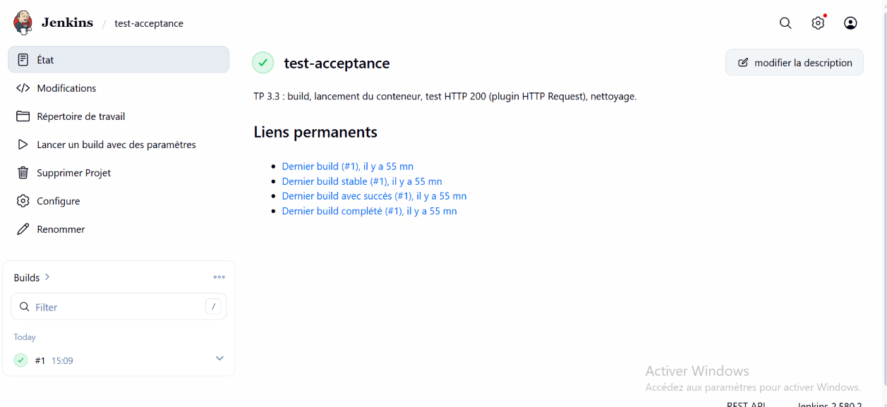
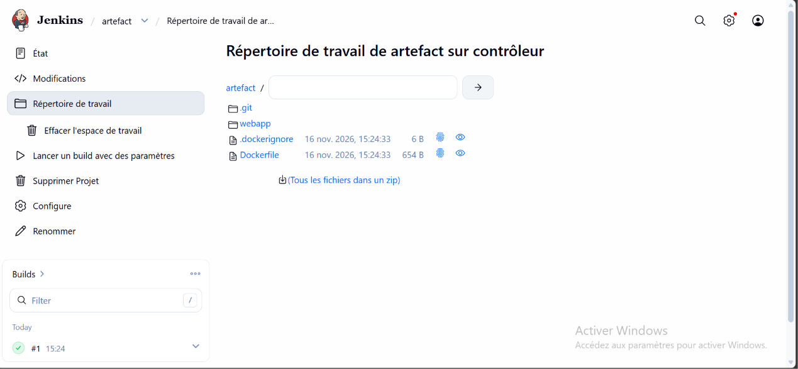
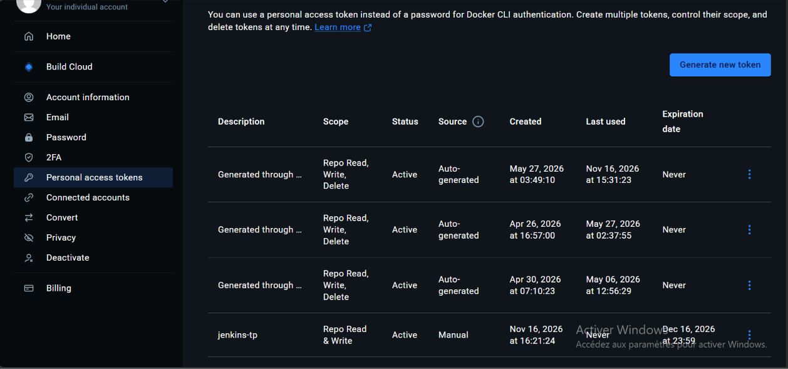
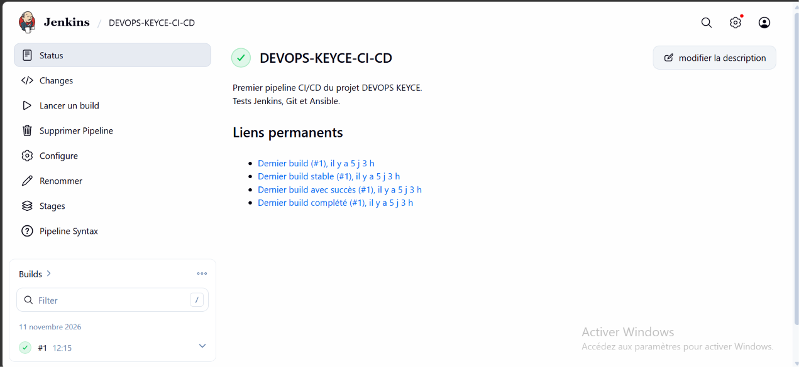
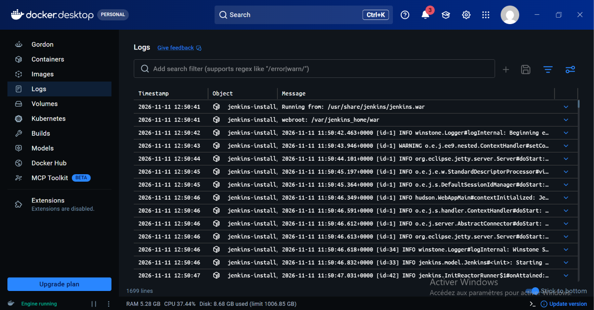
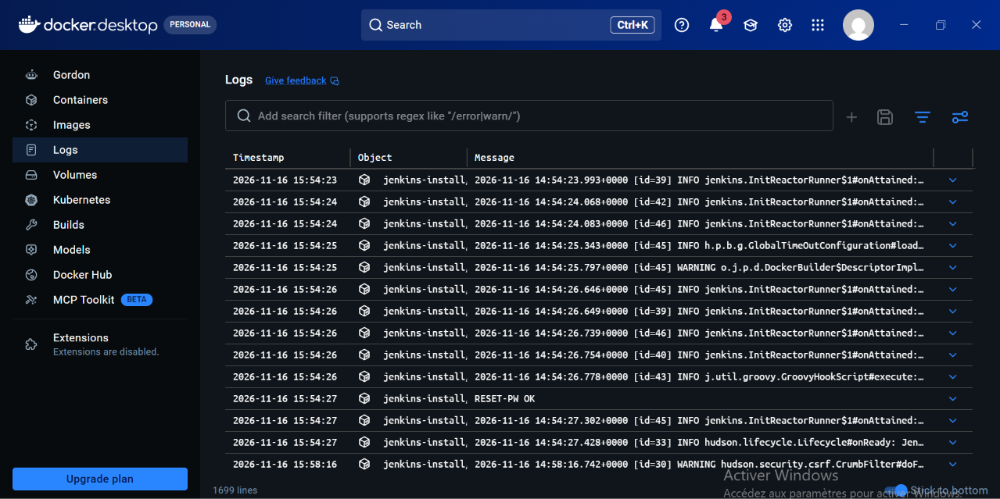

# Module 3 — Jenkins : TP 3.2, 3.3 et 3.4

**Statut :** terminé le 16/11/2026 — les 3 jobs ont été lancés depuis Jenkins et sont en **SUCCESS**.

## Environnement

- Jenkins LTS dans un conteneur, défini par [`jenkins-install/docker-compose.yml`](../jenkins-install/docker-compose.yml) : port **8185**, socket Docker de l'hôte monté, conteneur `ansible` sur le même réseau.
- Pour que Jenkins puisse lancer `docker build`, le client Docker a été ajouté dans le conteneur et le socket ouvert à l'utilisateur `jenkins` :
  `docker exec -u root jenkins chmod 666 /var/run/docker.sock` (à refaire après chaque redémarrage de Docker Desktop).
- Plugins installés : **HTTP Request** (TP 3.3) et **docker-build-step** (TP 3.4).
- Configuration des jobs exportée dans [`jobs/`](jobs/) (`config.xml` de chaque job).

## TP 3.2 — Job `build`

**Objectif :** un job *freestyle* paramétré (`IMAGE_NAME`, `IMAGE_TAG`, `Votre_ID_Github`) qui clone `alpinehelloworld` et construit son image.

**Résultat :** `build #1` → SUCCESS.

```
Successfully built 77c13afc0e0d
Successfully tagged alpinehelloworld:latest
Finished: SUCCESS
```

## TP 3.3 — Job `test-acceptance`

**Objectif :** prouver que l'image fonctionne : lancement du conteneur sur le port 80, requête HTTP qui doit répondre **200**, puis nettoyage.

**Résultat :** `test-acceptance #1` → SUCCESS.

```
HttpMethod: GET
URL: http://172.17.0.1
Response Code: 200
Success: Status code 200 is in the accepted range: 200
Finished: SUCCESS
```

`172.17.0.1` est l'adresse de l'hôte Docker vue depuis le conteneur Jenkins : c'est là que le port 80 du conteneur de test est publié.

## TP 3.4 — Job `artefact`

**Objectif :** publier sur Docker Hub l'image qui a passé le test (`gaddiela/alpinehelloworld:latest`).

- Credential Jenkins `dockerhub` (type *Username with password*) : identifiant `gaddiela` + jeton d'accès Docker Hub *Read & Write*. Le jeton n'apparaît jamais dans le script ni dans les logs.
- Le push est fait par une étape shell `docker login --password-stdin` + `docker push`, avec le credential injecté par le plugin *Credentials Binding*.

**Résultat :** `artefact #1` → SUCCESS, image visible sur https://hub.docker.com/r/gaddiela/alpinehelloworld

```
Success: Status code 200 is in the accepted range: 200
Login Succeeded
latest: digest: sha256:77c13afc0e0d8514c63b9e8fa2b294528b24d75736328dacd0941660dbc493cf size: 1622
Finished: SUCCESS
```

## Captures

**Tableau de bord : les 4 jobs en succès**


**Historique : build, test-acceptance, artefact et pipeline stables**


**TP 3.2 — job build #1 réussi**


**TP 3.3 — job test-acceptance #1 réussi**



**TP 3.4 — espace de travail du job artefact (dépôt cloné par Jenkins)**



**TP 3.4 — code de l'application (app.py, tests.py, wsgi.py)**


**TP 3.4 — jeton Docker Hub jenkins-tp (Read & Write, expire le 16/12/2026)**



**Docker Hub — dépôts du compte gaddiela**


**Premier pipeline DEVOPS-KEYCE-CI-CD (11/11/2026)**



**Logs de démarrage de Jenkins (Docker Desktop)**



**Logs du redémarrage de Jenkins (réinitialisation du mot de passe)**



### Captures encore à ajouter

- [ ] console de `test-acceptance #1` (ligne `Status code 200`)
- [ ] console de `artefact #1` (lignes `Login Succeeded` et push)
- [ ] page Docker Hub `gaddiela/alpinehelloworld` (rafraîchir la liste des dépôts)
- [ ] credential `dockerhub` masqué dans Jenkins (Manage Jenkins → Credentials)

## Problèmes rencontrés

| Symptôme | Cause | Solution |
|---|---|---|
| `docker: not found` dans le conteneur Jenkins | l'image Jenkins ne contient pas le client Docker | client Docker copié dans `/usr/local/bin` du conteneur |
| `permission denied … /var/run/docker.sock` | socket réservé à root | `chmod 666 /var/run/docker.sock` dans le conteneur |
| Lancement de job refusé par l'API | protection CSRF de Jenkins | utiliser le jeton *crumb* (ou lancer depuis l'interface) |
| Jeton Docker Hub en *Public Repo Read-only* | mauvais droits à la création | régénérer le jeton en **Read & Write** |
