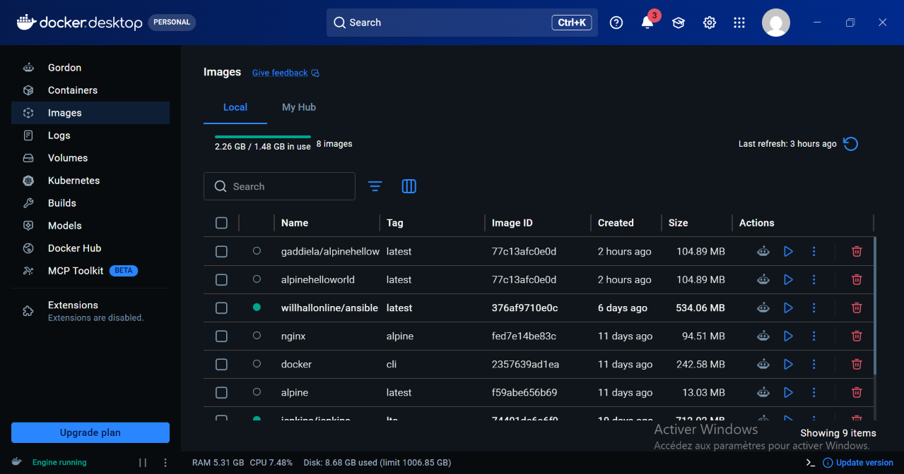
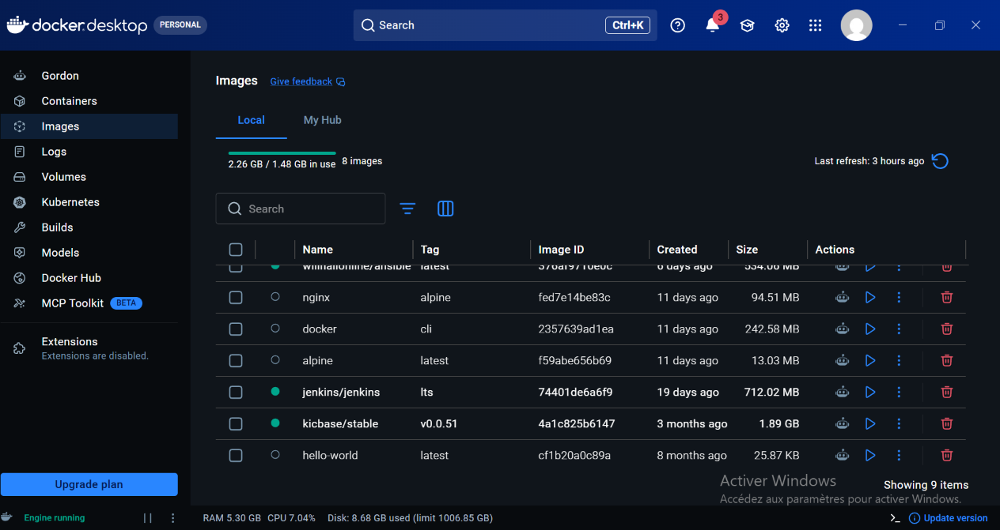
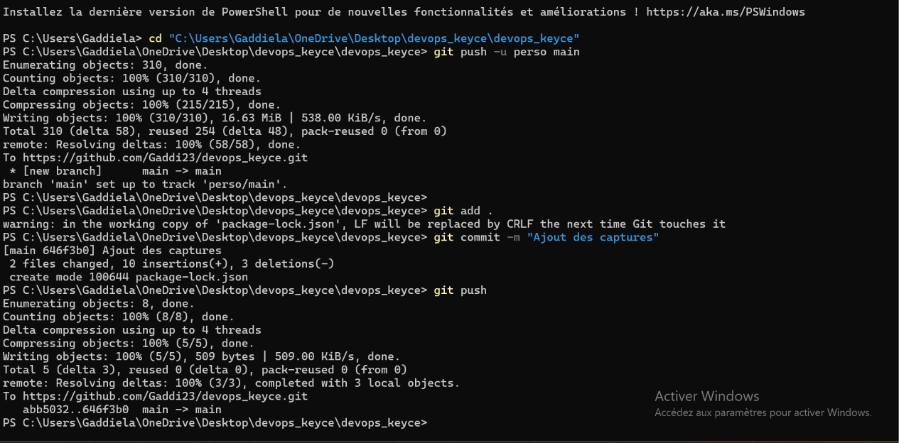

# Captures générales

**Images locales : gaddiela/alpinehelloworld, alpinehelloworld, ansible, nginx…**

**Images locales (suite) : jenkins, kicbase, hello-world**

**Envoi du dépôt sur GitHub (git push)**

